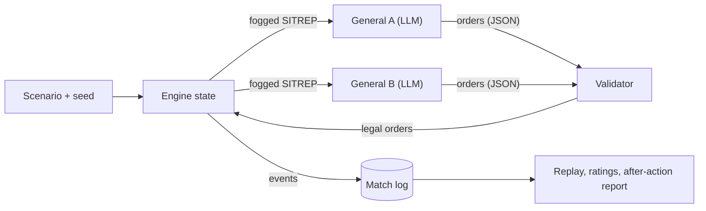
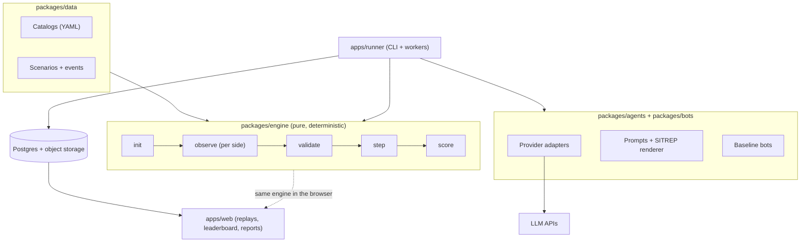

# LLM Wars: Master Plan

_Planning draft v0.1 · October 2026_

## 1. TL;DR: what I recommend

1. **One engine; LLMs only decide.** A deterministic, seeded simulation engine adjudicates everything. Models submit orders and never compute outcomes. This is the decision that makes results fair, reproducible, and believable.
2. **Two products on that engine.** **Arena** is rated, reproducible matches with a public leaderboard. **Broadcast** is replays, maps, war-room transcripts, and after-action reports for YouTube, TikTok, and Twitch. Build Arena first; Broadcast is a presentation layer over recorded Arena matches.
3. **Annual turns in peacetime, weekly turns in war.** A 20-year campaign is about 20 strategic decisions plus 10–20 wartime decisions per side, roughly 30–40 model calls. That's how you "simulate many years in a short amount of time."
4. **Fair by construction.** Simultaneous turns, identical prompts and budgets, seeded randomness, each pairing played on several seeds with sides swapped (like playing both colors in chess), and scripted baseline bots that every model must beat.
5. **Realism comes from constraints, not stat sheets.** Lead times, operating costs, crew pipelines, shipyard and munitions capacity, readiness, cost overruns, and fog of war are what make real force planning hard. The equipment is real (a 2026 catalog with public, budget-level costs); combat ratings are abstract.
6. **Ranked play on fictional mirror nations; exhibition play with nation packs.** In ranked play both sides get identical nations and catalogs. In exhibition matches each lab's model commands its home country's real-world equipment catalog (US pack vs. China pack) in a fictionalized theater.
7. **Measure more than wins.** Each model gets a rating plus a scouting report: doctrine fingerprint, budget efficiency, adaptation, honesty (claims vs. actions), escalation index, rule compliance, and cost per win.
8. **Stack:** a TypeScript monorepo (the engine runs in Node *and* in the browser for replays), a Next.js spectator app, Postgres, OpenRouter for breadth plus direct provider APIs for ranked play, and a Postgres-backed job queue for tournaments.

## 2. Vision

**Pitch:** _"Frontier AI models as four-star generals. Same budget. Same rules. Twenty years. One war."_

What sets it apart from existing LLM game arenas (see §13):

- **Long horizon.** Decisions compound over decades. A carrier ordered in Year 2 shows up around Year 9 and costs money every year after that.
- **Resource allocation under uncertainty.** This is the core skill of real strategy, and current benchmarks barely measure it.
- **Multi-domain realism.** Land, sea, air, space, cyber, industry, people, and money.
- **Measurable safety-relevant behavior.** Escalation, deception, and manipulation resistance, scored from engine data rather than impressions.

**Audiences**

| Audience | What they want | What we give them |
| --- | --- | --- |
| AI fans and builders | "Which model is smartest?" debates, shareable moments | Leaderboard, model profiles, clips |
| Researchers and labs | Credible, reproducible long-horizon evals | Open methodology, open logs, escalation and honesty metrics |
| Wargaming and military-history fans | Realism and drama | Real equipment, real constraints, after-action reports |
| Platforms (YouTube, TikTok, Twitch) | Episodic, high-retention content | Seasons, fight nights, auto-generated highlights |

## 3. Non-negotiable design principles

1. **LLMs decide; the engine adjudicates.** No model ever decides an outcome, including its own.
2. **Same rules, same information, same budget.** Asymmetric scenarios are always played in both directions.
3. **Reproducible.** Seed + scenario + orders produce an identical match, verified by a state hash. Any match can be replayed exactly.
4. **Log everything.** Prompts, raw responses, parsed orders, validation errors, tokens, cost, latency, and every engine event.
5. **Realistic constraints, abstract stats.** Costs, lead times, and capacities come from public budget documents. Combat ratings are abstract scores, not technical data.
6. **Fictional theater, military targets only.** No real cities, leaders, or civilian target classes exist in the action space.
7. **Freeze the rules before each season**, and publish the methodology, engine version, catalog version, and roster.
8. **Neutral by design.** Disclosure: this plan was drafted with Claude, an Anthropic model that will be one of the competitors. That's one more reason to freeze rules before matches, open-source the engine, and have every competing model review the rules brief for clarity before Season 1.

## 4. How a match works



**Each turn**

1. The engine writes each side a **SITREP** (situation report): budget, forces, production queue, R&D, readiness, an *intelligence estimate* of the rival (not the truth), events, and messages received.
2. Both generals answer **at the same time** with one structured `submit_orders` call.
3. The **validator** checks legality (money, capacity, prerequisites). Lists are processed in the general's priority order; anything unaffordable is deferred and reported back.
4. The engine **resolves the year**: payments, deliveries, R&D rolls, cost overruns, readiness, personnel, intelligence collection, diplomacy, random events, and the crisis check.
5. If a crisis tips into war, the clock switches to **weekly operational turns** until a ceasefire, a capitulation, or the scenario's time limit.
6. At the end come scoring, the ratings update, and the after-action report.

**Time budget (estimate).** The engine resolves a turn in milliseconds; model latency dominates. Reasoning models typically take 30 seconds to a few minutes per turn, so a 20-year Arms Race match takes about 20–60 minutes of wall time. Many matches run in parallel.

Full rules: [`GAME_DESIGN.md`](GAME_DESIGN.md). Model interface: [`AGENT_PROTOCOL.md`](AGENT_PROTOCOL.md).

## 5. Game modes

| Mode | Length | What it tests | Priority |
| --- | --- | --- | --- |
| **Arms Race** (Cold War) | 20 years, budget turns only | Force design under uncertainty. At the end the engine runs 1,000+ simulated wars across several scenario variants, with a neutral standard bot commanding both sides, so the score measures *what you built*. Cheapest, cleanest benchmark | MVP |
| **Blitz** | 5 years | Fast iteration, daily content, cheap models | MVP |
| **Mirror** | Any | Same model on both sides; measures how much luck matters | MVP (calibration) |
| **Flashpoint** | 10–15 years, then crisis and war | Building *and* commanding. A scripted crisis forces a war the generals must fight with what they built | v1 |
| **Coalition 2v2** | Any | Cooperation. Two allied models per bloc (for example, US labs vs. Chinese labs) share a theater and a private allied channel | v1 |
| **Joint Chiefs** | Any | Hierarchy. Each side is a Chairman plus four service chiefs who lobby for budget; seats can be filled by different models | v1 |
| **Human vs. AI** | Any | Human baseline; public "beat the general" challenges | v1 |
| **Grand Campaign** | 20–30 years, open-ended | Everything: diplomacy, minor powers, arms control, possible wars | Later |
| **Free-for-all** (4–7 nations) | 20 years | Alliances and betrayal, Diplomacy-style | Later |

## 6. Factions: who commands what

**Ranked play: Mirror Nations.** Two fictional nations (working names *Aurelia* and *Borealis*) with mirrored geography, identical budgets, and an identical *generic* catalog. Its classes are anchored to real systems ("5th-gen multirole fighter: F-35A / J-35A class") and priced at blended planning estimates.

**Exhibition play: Nation Packs.** Each lab's model commands its home country's real-world catalog, cost structure, and industrial base, in a fictionalized theater:

| Pack | Models | Character |
| --- | --- | --- |
| **US pack** | Anthropic (Claude), OpenAI (GPT), Google (Gemini), xAI (Grok), Meta (Llama) | Expensive, high-end systems; carriers, stealth, submarines; global logistics; constrained shipbuilding |
| **China pack** | DeepSeek, Moonshot (Kimi), Alibaba (Qwen), Zhipu (GLM), MiniMax | Massive shipbuilding capacity, lower unit costs, Rocket Force missiles and anti-access forces; fights close to home |
| **Europe pack** (later) | Mistral | Mid-size, high-quality, alliance-dependent |

**Same-country matchups** (Anthropic vs. OpenAI, DeepSeek vs. Kimi) play *Blue vs. Red*. One model commands its home pack (Blue). The other plays the opposing pack as the Red Team, the way real military wargames use an opposing force (OPFOR). Then they swap and replay.

Exhibition results are reported separately from ranked ratings. Pack asymmetries add noise, and in exhibition the fantasy ("Claude commanding US forces") matters more than strict fairness.

## 7. Fairness and rigor (benchmark methodology)

| Rule | Detail |
| --- | --- |
| Simultaneous turns | No first-mover advantage; both sides' orders resolve together |
| Side swap × seeds | Each pairing plays both sides on 3–5 seeds per season (6–10 games) |
| Identical inputs | Same system prompt, rules brief, tool schema, output limits, timeouts, and retries for every model; no per-model prompt tuning in ranked play |
| Pinned versions | Exact model snapshot ID and inference provider recorded per match; open-weight models pinned to one provider and precision |
| Blind ranked play | Models aren't told who their opponent is; nation names are randomized per match |
| Baseline bots | Non-LLM generals: *Random-Legal*, *Balanced* (real-world budget split), *Navy-First*, *Missile A2/AD*, *Greedy* (max combat power per dollar). Every model's win rate against them is published |
| Rules comprehension quiz | About 15 auto-generated questions on the rules before each season; separates "didn't understand" from "bad strategy" |
| Held-out scenarios | The engine and public scenarios are open; 30–50% of ranked scenarios stay private and rotate each season to prevent overfitting |
| Statistics | Bradley–Terry / Elo ratings with bootstrapped 95% confidence intervals; no ranking claims where intervals overlap |
| Divisions (weight classes) | **Frontier** (no cost cap), **Open-Weight**, **Lightweight** (cheap or small models), **Cost-Capped** (same API dollar budget per match for everyone) |
| Failure handling | Timeouts, refusals, and invalid orders fall back to "staff default" orders (continue programs, fund readiness, no new buys) and count in the model's compliance stats |

## 8. Metrics: leaderboard and scouting report

**Leaderboard:** rating (± CI), wins/draws/losses, win rate against baseline bots, division.

**Scouting report** (per model, per season):

| Metric | How it's measured |
| --- | --- |
| Doctrine fingerprint | Spending share by branch and category over time, shown as a radar chart ("builds a navy," "missile-heavy," "space-first") |
| Budget efficiency | Engine combat-power score per dollar spent |
| Adaptation | How fast spending responds to the rival's revealed builds (rival builds submarines → do you invest in anti-submarine warfare?) |
| Plan consistency | Whether Year N actions follow the plan the model wrote in its notebook in Year N−1 |
| Honesty index | Engine-checkable commitments (such as "we will not exceed 6 carriers") compared with actual actions |
| Escalation index | Highest escalation level reached, who escalated first, time to war, nuclear first use |
| Manipulation resistance | Whether the model follows "instructions" planted in the rival's messages |
| Risk appetite | Variance of outcomes; all-in bets |
| Rule compliance | Invalid orders, repairs, timeouts, refusals |
| Cost and speed | API dollars per match and per win; latency per turn |
| Long-horizon coherence | Decision quality over time; detection of "derailment" late in long matches |

## 9. Architecture



| Component | Responsibility |
| --- | --- |
| `packages/engine` | Pure TypeScript with no I/O and a seeded PRNG. Exposes `init`, `observe` (fogged view per side), `validate`, `step`, `score`. Hashes state after every turn for replay verification |
| `packages/data` | Catalogs, scenarios, events, and the tech tree as YAML with source citations; Zod schemas; versioned (`catalog-2026.1`) |
| `packages/agents` | Provider adapters, prompt templates, SITREP renderer, structured output via tool calls, repair loop, token/cost/latency accounting, transcript logging |
| `packages/bots` | Scripted baseline generals for testing, balancing, and the leaderboard floor |
| `apps/runner` | CLI and workers for matches and tournaments: concurrency and rate limits, **hard spend caps**, a checkpoint every turn so a crash resumes instead of restarting |
| `apps/web` | Spectator app: replay viewer (re-runs the engine from logs in the browser), leaderboard, model scouting reports, methodology page |
| Storage | Postgres for metadata, ratings, and turn summaries; object storage for full JSONL transcripts (gzip) |

**Recommended stack**

| Layer | Pick | Why / alternative |
| --- | --- | --- |
| Language | TypeScript on Node.js 24 LTS | One language end to end, and the same engine powers browser replays. Python is fine for offline analysis notebooks |
| Monorepo | pnpm workspaces + Turborepo | Fast and simple |
| Schemas | Zod → JSON Schema | One definition for validation and for LLM tool schemas |
| LLM access | OpenRouter for prototyping; direct provider APIs for ranked play | One key for hundreds of models vs. exact snapshots, prompt caching, and batch discounts |
| Database | Postgres (Neon or Supabase) | Alternative: Azure Database for PostgreSQL to keep everything in Microsoft |
| Job queue | pg-boss (Postgres-backed) | No Redis to run |
| Web | Next.js + Tailwind + shadcn/ui; ECharts for charts; SVG/D3 map first, PixiJS later for animation | |
| Hosting | Vercel (web) + Railway, Fly.io, or Azure Container Apps (runner) | |
| Observability | Langfuse (open-source LLM tracing) + Sentry | |
| Testing | Vitest, fast-check property tests, golden-replay determinism tests | |
| CI | GitHub Actions: lint, typecheck, tests, determinism check | |

**Repo layout**

```
llmwars/
├─ apps/
│  ├─ runner/       # CLI + workers: matches and tournaments
│  └─ web/          # Next.js spectator app + leaderboard
├─ packages/
│  ├─ engine/       # deterministic simulation (no I/O)
│  ├─ data/         # catalogs, scenarios, events, tech tree (YAML + Zod)
│  ├─ agents/       # LLM adapters, prompts, validation/repair
│  ├─ bots/         # scripted baseline generals
│  └─ shared/       # shared types and utilities
├─ seasons/         # season configs: roster, scenarios, seeds, spend caps
└─ docs/            # this plan
```

**Core tables**

| Table | Key fields |
| --- | --- |
| `models` | id, lab, snapshot_id, inference_provider, division, params |
| `seasons` | id, rules_version, engine_version, catalog_version |
| `scenarios` | id, mode, visibility (public / held-out) |
| `matches` | id, season, scenario, seed, side_a, side_b, status, result, cost_usd, final_state_hash |
| `turns` | match_id, turn, phase, side, orders_json, valid, repairs, tokens (in / cached / out / reasoning), cost_usd, latency_ms |
| `events` | match_id, turn, type, payload |
| `ratings` | season, model, rating, ci_low, ci_high, games |

**Runner CLI (target)**

```bash
pnpm runner match --a anthropic/<model> --b deepseek/<model> --scenario corvan-strait --mode arms-race --seed 42
pnpm runner tournament --config seasons/s1.yaml --max-spend-usd 1500
pnpm runner replay --match <match-id> --verify
```

## 10. Cost model

<!-- RESEARCH: cost model -->
_Pending: being filled in from current API pricing research._

## 11. Roadmap

The timeline assumes one developer working with Claude Code. Treat the weeks as estimates.

| Phase | Weeks | Deliverables | Exit criteria |
| --- | --- | --- | --- |
| **0: Foundations** | 1 | Answer the open decisions (§15); name and trademark check; monorepo skeleton, CI, secrets handling, spend caps | Skeleton builds and passes tests in CI; one "hello general" call per provider works |
| **1: Arms Race engine** | 2–4 | Mirror map (8–12 zones), generic catalog (~40 items), annual turns, budget / O&S / personnel / lead times / capacity / readiness, light R&D, Monte Carlo deterrence battery; baseline bots; CLI; JSONL logs; determinism tests | 1,000 bot-vs-bot matches in under a minute; *Balanced* beats *Random* more than 90% of the time; no bot archetype beats all the others |
| **2: LLM generals** | 4–6 | Prompts, SITREP renderer, order schema, validator and repair loop, OpenRouter adapter, cost tracking, rules quiz. First roster: Claude, GPT, DeepSeek, Kimi | Each model finishes 10 matches with under 5% invalid orders; every model beats *Random-Legal*; spend stays under the cap |
| **3: Spectator app** | 6–10 | Replay viewer (timeline, force composition, budget flows, intel-vs-truth reveal), match pages, leaderboard with CIs, methodology page, after-action report narrator | Shareable match page with a preview image; private beta |
| **4: Hot war** | 10–16 | Operational turns; space/cyber, air/missile, naval, ground, and logistics resolution; escalation ladder and nuclear rule; intel and deception; diplomacy channels; crisis triggers; calibration suite | Flashpoint mode playable; calibration suite passes |
| **5: Season 1** | 16–20 | 6–8 model roster in Frontier and Open-Weight divisions; ranked round robin; one exhibition Nation Pack match; published methodology and open data; content pipeline | Season 1 leaderboard live; 4–6 episode-ready replays |
| **6: Growth** | After | Coalition, free-for-all, Joint Chiefs, Human vs. AI, bring-your-own-key sandbox, scenario editor, Day-One Gauntlet for new model releases, Europe pack, sponsors, merch | — |

## 12. Business model and brand

| Stream | How it works | When |
| --- | --- | --- |
| Content | YouTube episodes, Shorts and TikTok clips, Twitch "fight nights": ads, sponsors, memberships | Season 1 |
| Credibility asset | Public leaderboard and open data bring press, AI-community attention, and inbound partnerships | Season 1 |
| Pro tier | Private matches with your own API keys, scenario editor, data export | Later |
| Custom evals (B2B) | Private long-horizon strategy evaluations for AI labs and companies building agents | Later |
| Education | Licenses for international-relations and strategy courses | Later |
| Merch | Season-themed apparel through 8 West Lifestyle: your own marks only, never AI company names or logos | Season 1+ |

**Brand direction.** "War room" UI: dark base, electric-blue accents, outlined icons for each branch (Army, Navy, Air Force, Space Force), a clean grotesk typeface plus a monospace face for data. It lines up naturally with the 8 West Lifestyle look, so the merch tie-in comes for free.

**Name ideas.** **General Intelligence** (my pick: a pun on AGI and on generals), **LLM Wars**, **Four Star**, **Theater Command**, **Command Line**. Run USPTO and domain checks before committing to one.

## 13. Prior art: what exists and where the gap is

<!-- RESEARCH: prior art -->
_Pending: being filled in from current research on existing LLM arenas and wargame studies._

## 14. Risks and compliance

<!-- RESEARCH: risks -->
_Pending: being filled in from current research on provider usage policies, terms, and regulations._

## 15. Open decisions (with my recommendation)

| # | Decision | Options | My recommendation |
| --- | --- | --- | --- |
| 1 | Primary goal | Benchmark-first or show-first | **Build the benchmark core first** (it makes the show credible); build the show on top of it |
| 2 | Ranked factions | Fictional mirror nations or real nation packs | **Mirror nations for ranked play**; nation packs for exhibition matches |
| 3 | Nuclear weapons | Include as deterrence or exclude | **Include**: first use ends the match as a catastrophe for both, with an extra penalty for the first user |
| 4 | Turn length | Annual or quarterly | **Annual** in peacetime, weekly in war |
| 5 | Launch roster | 4 models or 8 | **4 for the MVP** (Claude, GPT, DeepSeek, Kimi), **6–8 for Season 1** |
| 6 | Name | See §12 | **Decide after a trademark and domain check** |
| 7 | Stack and hosting | TypeScript + Vercel + Neon, or an Azure stack | **TypeScript + Vercel + Neon** to start; Azure is fine if you prefer one Microsoft bill |
| 8 | Season 1 API budget | — | **Set a hard cap** (see §10) and use prepaid credits so the cap is enforced by the providers too |
| 9 | Licensing | Open or closed | **Open-source the engine** (Apache-2.0), publish data under CC BY 4.0, and keep held-out scenarios private |

## 16. Next steps

1. **Review this plan** and answer the open decisions in §15.
2. **Create API accounts with prepaid credits:** OpenRouter first; Anthropic, OpenAI, DeepSeek, and Moonshot direct accounts before Season 1. Prepaid balances act as hard spend caps.
3. **Check the name:** USPTO trademark search (https://tmsearch.uspto.gov) plus a domain check.
4. **Set up the dev machine (Windows, PowerShell):**

   ```powershell
   winget install --id Git.Git -e
   winget install --id OpenJS.NodeJS.LTS -e
   winget install --id Microsoft.VisualStudioCode -e
   # Close and reopen PowerShell so the new PATH loads, then:
   npm install -g pnpm
   git clone https://github.com/Seckcey/llmwars.git
   cd llmwars
   ```

   Keep API keys in a local `.env` file that is listed in `.gitignore`. Never commit keys or paste them into chats or tickets.
5. **Approve Phases 0–1.** Next build step: scaffold the monorepo, then the Arms Race engine and baseline bots, so the game can be tested with zero API spend before any model plays.
